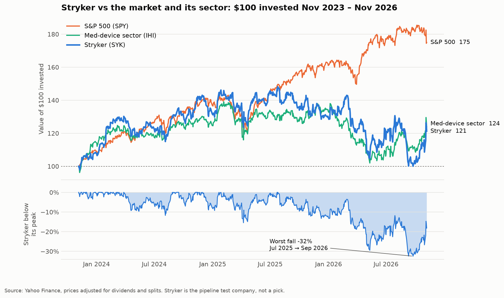
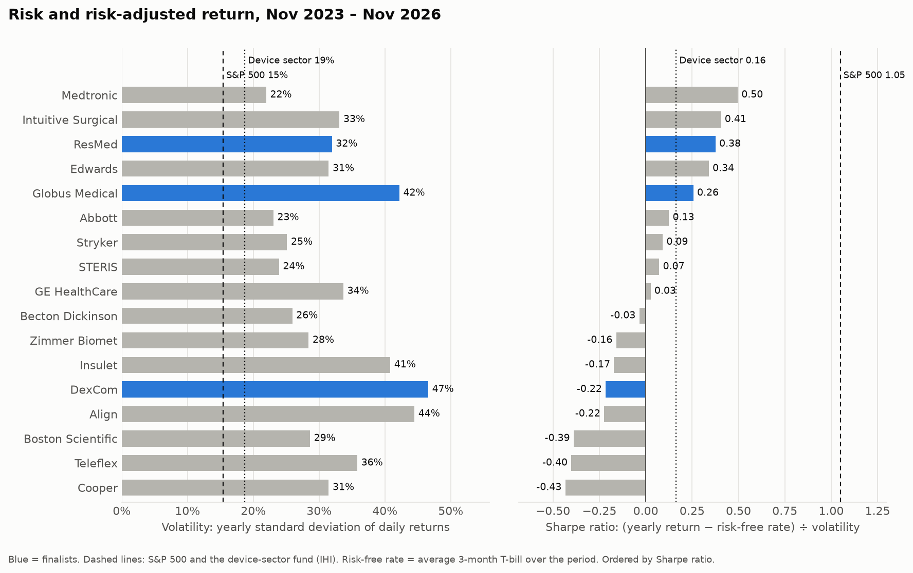
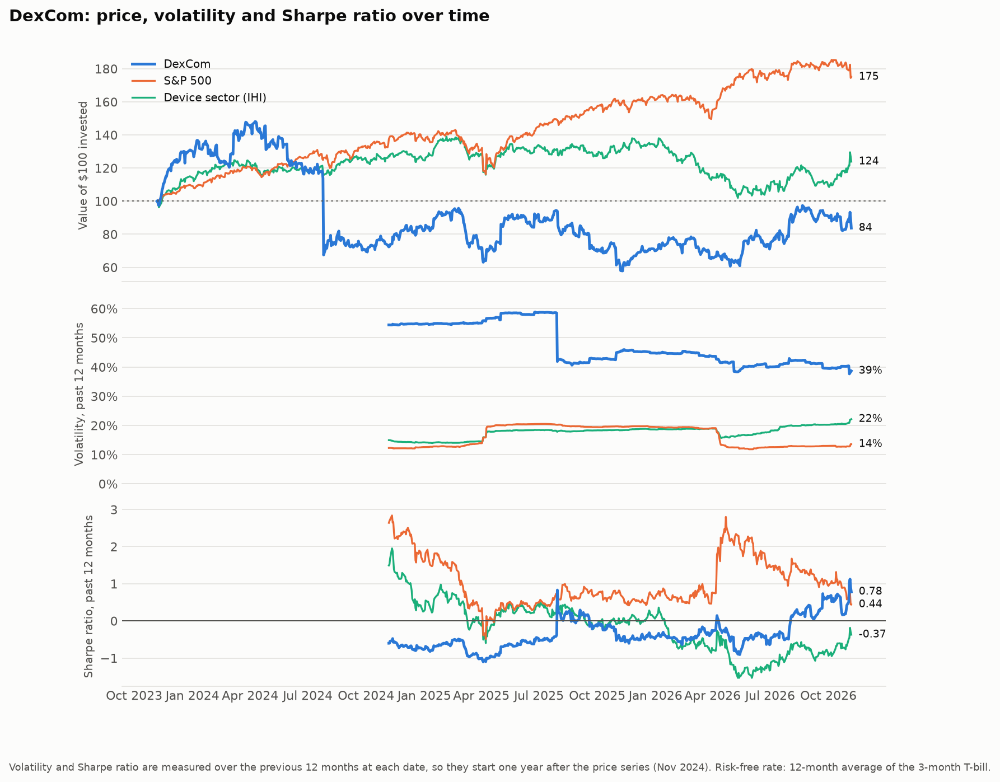
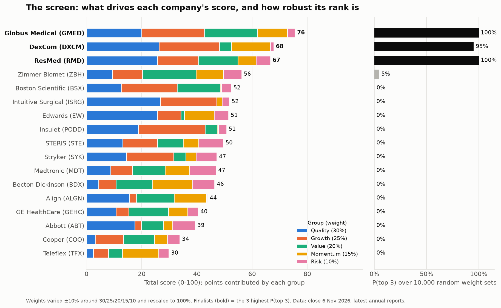
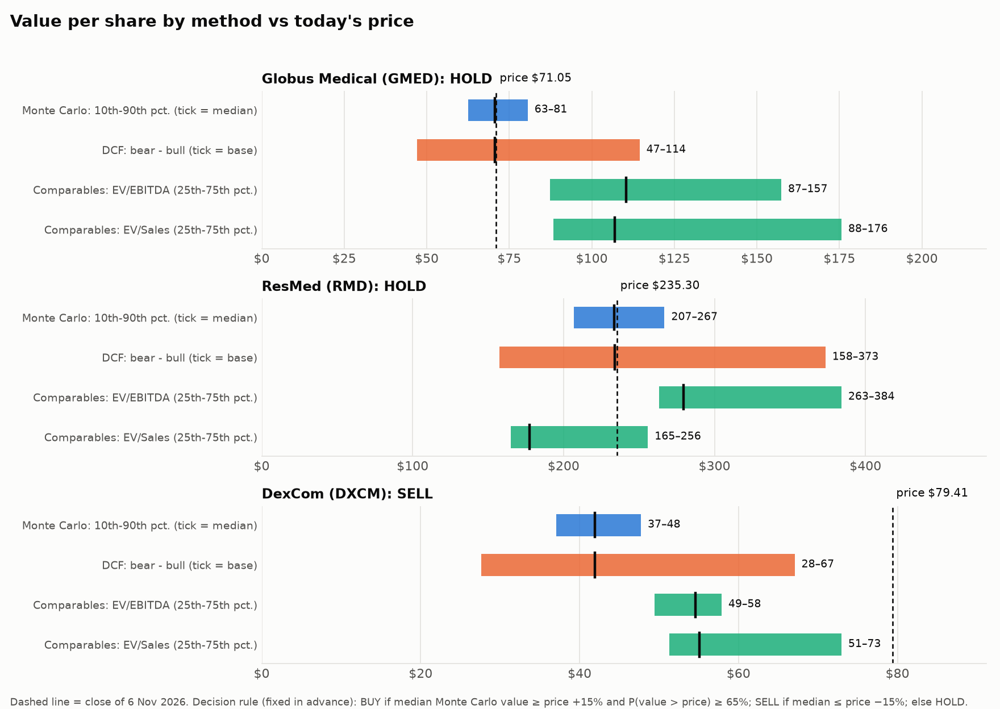
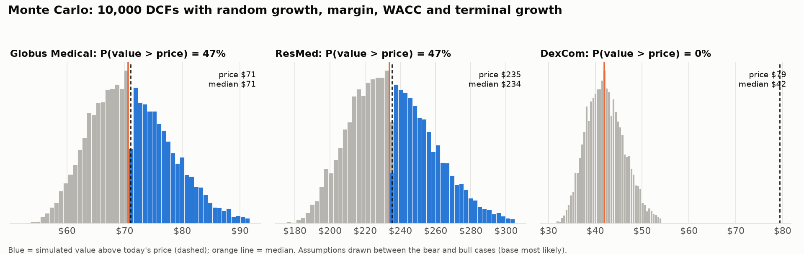

# MedTech Investment Research Engine

## At a glance

**Question:** among 17 large US medical-device companies, which offer the best mix of quality, growth and value, and are they worth buying at today's prices (6 Nov 2026)?

**Answer:** a 12-metric screen, robust to 10,000 random weightings, picked **Globus Medical, ResMed and DexCom**. Valuing them (DCF, reverse DCF, comparables, 10,000-run Monte Carlo) gives **Globus HOLD, ResMed HOLD, DexCom SELL**.
- Globus and ResMed are priced for almost exactly the growth they guide to (implied 5.1% and 7.1% vs ~5% and ~7%).
- DexCom's price needs ~28% growth next year vs 12–13% guided.

→ **[Investment memo](reports/investment_memo.md)** · **Interactive report with Monte Carlo simulation: open [app/index.html](app/index.html) in a browser** · [Ranking chart](outputs/charts/02_ranking.png) · [Valuation chart](outputs/charts/03_valuation_ranges.png)

**The interactive report** ([app/index.html](app/index.html)): the whole project as one page in six sections (approach, data, screen, valuation, Monte Carlo, conclusions), with numbered figures and tables. Every company in the ranking can be expanded to show its 12 metrics. For each finalist, the Monte Carlo section lets you change the assumptions and re-run 10,000 simulations, with the distribution, its convergence and a sensitivity chart explained in text. The page uses a JavaScript port of the Python model, tested to match it to the cent.

**Why the numbers can be trusted**
- Every rule was fixed before seeing results, and the decision log (section 12) records every choice, including two declared method changes.
- Every company's revenue and operating profit were cross-checked against its own SEC 10-K (34/34 match).
- 12 data problems were found and fixed: an intraday price disguised as a close, restated revenue, a spin-off recorded as a stock split, a pending takeover pinning a share price, and more.
- 83 automatic tests, including a check that the browser engine reproduces the Python valuation.

**Run it:** `pip install -r requirements.txt`, then `python -m src.run_all` (downloads the data and runs every step in the right order; add `--no-download` to re-run from the saved data), and `python -m pytest` (tests). Tested from a fresh clone with all outputs deleted: same finalists, ranking and decisions. Python · pandas · NumPy · SciPy · matplotlib · yfinance · SEC XBRL API · FRED.

> *A learning project, not investment advice.* Below: the results session by session, then the original plan, which was written before any data was looked at.

---

## Progress and findings

### Session 1: Stryker data, loaded and checked ✅



**Reproduce it:** `python -m src.session1` (downloads everything, runs the checks, redraws the chart).

**1. Yahoo Finance vs Stryker's official 10-K (FY2025, $ millions)**

| Item | Yahoo | 10-K | Difference | Match |
|---|---|---|---|---|
| Revenue | 25,116 | 25,116 | 0.0% | ✅ |
| Operating income: Yahoo's plain "Operating Income" | 5,059 | 4,889 | +3.5% | ❌ (adds back one-off charges; see finding 2) |
| Operating income: Yahoo's "As Reported" line | 4,889 | 4,889 | 0.0% | ✅ (used from Session 2 on) |
| Net income | 3,246 | 3,246 | 0.0% | ✅ |
| Operating cash flow | 5,044 | 5,044 | 0.0% | ✅ |
| Capital expenditure | −761 | −761 | 0.0% | ✅ |
| Total debt | 15,859 | 15,859 | 0.0% | ✅ |
| Cash | 4,011 | 4,011 | 0.0% | ✅ |
| Shares outstanding (m) | 382.5 | 382.7 | −0.1% | ✅ (cover-page count is dated one month later) |

Source: Stryker 10-K, accession 0000310764-26-000010, filed 11 Feb 2026, via the SEC's XBRL data. Stored with its source in [data/manual/SYK_10K_FY2025.csv](data/manual/SYK_10K_FY2025.csv).

**2. First numbers for Stryker**

| | Stryker | S&P 500 | Device sector (IHI) |
|---|---|---|---|
| 3-year total return | 21.2% | 75.0% | 23.9% |
| Return per year | 6.6% | 20.5% | 7.4% |
| Volatility (yearly) | 25.1% | 15.4% | 18.7% |
| Maximum drawdown | −32.5% (Jul 2025 → Sep 2026) | −18.8% | −26.6% |

| Business (FY2025) | |
|---|---|
| Revenue | $25.1bn |
| Revenue growth, 3-yr CAGR (2022–25) | 10.8% a year |
| Free cash flow | $4.3bn |
| FCF margin | 17.1% |

*Prices to the close of 6 Nov 2026.*

**3. What this tells us so far**
- **The business grew faster than the share price.** Revenue compounded at 10.8% a year, but the shares returned only 6.6% a year, so the market now pays less for each dollar of sales than it did 3 years ago. Whether that makes Stryker cheap or the old price too high is exactly what the valuation stage has to answer.
- **The whole sector lagged the market.** $100 in device stocks became $124; $100 in the S&P 500 became $175. Stryker's story is mostly a sector story, which is why the screen measures momentum *relative to IHI*, not just in absolute terms.
- **Stryker was bumpier than its sector** (25% vs 19% volatility) and had a deeper worst fall (−32% vs −27%).

**4. Data-quality findings** (each one changed the code)

| # | Finding | How it was caught | What was done |
|---|---|---|---|
| 1 | A download during US trading hours returns a **mid-day price disguised as a close**. | The last row had a quarter of the normal trading volume; the download was at 12:04 New York time. | `drop_unfinished_day()` now removes any unfinished day automatically and warns. |
| 2 | Yahoo's plain **"Operating Income" is 3.5% higher** than the 10-K. In Session 2 the cause was found: Yahoo adds back "special charges" ($170m in 2025, $977m in 2024). Stryker has had these "one-offs" every year from 2022 to 2025. | Line-by-line check against the 10-K, then a search of Yahoo's other income-statement lines. | Yahoo's **"Total Operating Income As Reported"** line matches the 10-K exactly, and is now used everywhere (decision log). |
| 3 | Yahoo's **2024 EBITDA looked too low**: only $0.3bn above *adjusted* operating income, when 2024 D&A was $1.05bn. Explained in Session 2: Yahoo's EBITDA is *after* the $977m special charge of 2024, while its "Operating Income" is *before* it. The two lines use different definitions. | Sanity check: EBITDA must be well above operating income. | EBITDA is built ourselves as as-reported operating income + D&A, so both use one definition. |
| 4 | Yahoo's **oldest financial year is almost empty** (45 of 46 lines missing). | Counted missing values per column. | Mostly-empty years are dropped; 4 usable years (2022–25) remain, as the plan needs. |


### Session 2: the 12 screening metrics for Stryker, hand-checked ✅

**Reproduce it:** `python -m src.session3` (the Session 2 code was folded into Session 3, which runs the same calculation for every company). Every formula with the real numbers plugged in: [outputs/tables/workings/SYK.md](outputs/tables/workings/SYK.md).

| Group | Metric | Workings ($ millions) | Stryker |
|---|---|---|---|
| Quality | ROIC | 4,889 × (1 − 19.5%) ÷ (15,859 debt + 22,420 equity − 4,100 cash) | **11.5%** |
| Quality | FCF margin | (5,044 operating cash flow − 761 capex) ÷ 25,116 revenue | **17.1%** |
| Quality | Net debt / EBITDA | (15,859 − 4,100) ÷ (4,889 operating income + 1,193 D&A) | **1.93x** |
| Growth | Revenue growth (3-yr) | (25,116 ÷ 18,449)^(1/3) − 1 | **10.8%** |
| Growth | Operating profit growth (3-yr) | (4,889 ÷ 2,841)^(1/3) − 1 | **19.8%** |
| Value | EV / EBITDA | (124,645 market cap + 15,859 − 4,100) ÷ 6,082 | **22.4x** |
| Value | FCF yield | 4,283 ÷ 124,645 ($325.87 × 382.5m shares) | **3.4%** |
| Momentum | 12-1 month return | $278.20 (6 Oct 2026) ÷ $349.93 (6 Nov 2025) − 1 | **−20.5%** |
| Momentum | Return vs sector (12m) | SYK −6.9% minus IHI −4.6% | **−2.2%** |
| Risk | Volatility | 1.58% daily std. dev. × √252 (753 days) | **25.1%** |
| Risk | Beta | weekly returns vs S&P 500 (156 weeks) | **0.53** |
| Risk | Max drawdown | $268.90 (24 Sep 2026) ÷ $398.20 (25 Jul 2025) − 1 | **−32.5%** |
| *Reported* | Sharpe ratio | (6.6% yearly return − 4.3% avg. T-bill) ÷ 25.1% | *0.09* |

Price: close of 6 Nov 2026. Financials: FY2025. Cash = cash + short-term investments (4,011 + 89; Session 3 decision). Tax rate: 3-year pooled effective rate. Risk-free rates from FRED ([outputs/tables/risk_free_rates.csv](outputs/tables/risk_free_rates.csv)): 3-month T-bill averaged 4.33% over the 3 years; 10-year Treasury 4.84% (5 Nov 2026). FRED publishes with a one-day lag: when this session first ran, the latest value was 4.90% (4 Nov); the rate date is now pinned to 5 Nov in `config/settings.py` so every re-run gives the same answer.

**How the numbers were checked**
- **By hand:** every row above can be recomputed with a calculator from the workings column.
- **Independently:** volatility, beta (as a regression slope), drawdown and both momentum figures were recomputed straight from the raw CSV files with different code. All matched.
- **Automatically:** 34 tests check every formula on made-up examples with known answers, including edge cases (losses, negative EBITDA, missing data, weekends).

**What Stryker's numbers say** (on their own they mean little; Session 3 ranks them against 19 peers)
- **Margins are expanding.** Operating profit grew almost twice as fast as revenue (19.8% vs 10.8% a year): the operating margin went from 15.4% to 19.5%. Part of this is a low 2022 base (that year had $270m of special charges).
- **Investors pay for growth, not current cash.** The FCF yield (3.4%) is **below** the 10-year Treasury yield (4.9%): buying Stryker today only makes sense if its cash flows keep growing. The reverse DCF (Session 6) will put a number on how much growth the price assumes.
- **Low beta, high volatility.** Stryker moves only about half as much as the market (beta 0.53), yet its price swings more than the market's (25% vs 15% volatility). So most of its risk is **company-specific**, not market-driven, and in a diversified portfolio much of that risk would cancel out.
- **The trend is negative.** Down 20.5% on the 12-1 measure and slightly behind the sector over 12 months: momentum will count against it in the screen.


### Session 3: the whole universe, every company × every metric ✅

**Reproduce it:** `python -m src.session3`. Outputs in [outputs/tables/](outputs/tables/): `universe_eligibility.csv`, `metrics_all.csv`, `sec_crosscheck.csv`, `data_flags.csv`, and a hand-check document per company in [outputs/tables/workings/](outputs/tables/workings/).

**1. Who is in: 17 of 21 candidates**

| Company | Decision | Why | Source |
|---|---|---|---|
| Hologic (HOLX) | OUT | Taken private by Blackstone and TPG; delisted 7 Apr 2026 | [360Dx](https://www.360dx.com/business-news/blackstone-tpg-complete-hologic-acquisition) |
| Masimo (MASI) | OUT | Acquired by Danaher at $180/share; delisted 10 Jun 2026 | [Investing.com](https://www.investing.com/news/sec-filings/danaher-completes-acquisition-of-masimo-company-delists-from-nasdaq-93CH-4735810) |
| Penumbra (PEN) | OUT | Agreed takeover by Boston Scientific at $374/share, pending (FTC review, close expected Q1 2027). Its price now tracks the deal terms, not the business: 60-day daily volatility 0.5% vs ~2% for peers | [MLex](https://www.mlex.com/mlex/articles/2543499/boston-scientific-says-penumbra-close-will-push-into-q1-2027) |
| Baxter (BAX) | OUT | Rule 4: as-reported operating loss of −$308m in 2025, after a $485m write-down. (Before the write-down it would be +$177m, but the rule fixed in advance uses as-reported figures; Baxter also lost −$2.8bn in 2022.) | Yahoo, cross-checked with 10-K |
| Teleflex (TFX), Becton Dickinson (BDX) | IN, flagged | Selling or separating businesses: see data finding 9 | [BD](https://news.bd.com/2026-02-09-BD-Completes-Combination-of-Biosciences-Diagnostic-Solutions-Business-with-Waters-Corporation), [Teleflex 10-Q](https://www.sec.gov/Archives/edgar/data/0000096943/000009694326000109/tfx-20260930.htm) |

All events and sources: [data/manual/corporate_events.csv](data/manual/corporate_events.csv). Two independent confirmations of the delistings: Yahoo has no prices for them, and the SEC's own records list no ticker for either company.

**2. The 12 metrics for all 17 companies** (price: close of 6 Nov 2026; financials: each company's latest annual report)

| Company | FY end | Mkt cap $bn | ROIC | FCF margin | Net debt/EBITDA | Revenue growth | Op. profit growth | EV/EBITDA | FCF yield | 12-1 mom. | vs sector | Volatility | Beta | Max DD |
|---|---|---|---|---|---|---|---|---|---|---|---|---|---|---|
| Medtronic (MDT) | 2026-04 | 130 | 7.6% | 14.9% | 2.0x | 5.2% | 5.6% | 15.8x | 4.2% | -0.1% | 21.4% | 22.0% | 0.27 | -28.9% |
| Abbott (ABT) | 2025-12 | 191 | 14.1% | 16.7% | 0.4x | 0.5% | -1.2% | 17.5x | 3.9% | -20.0% | -5.2% | 23.0% | 0.11 | -39.6% |
| Becton Dickinson (BDX) | 2025-09 | 60 | 5.2% | 12.2% | 3.7x | 5.0% | 4.2% | 15.7x | 4.4% | 32.5% | 60.4% | 25.9% | 0.28 | -34.6% |
| GE HealthCare (GEHC) | 2025-12 | 38 | 12.8% | 7.3% | 1.8x | 4.0% | 3.1% | 13.0x | 4.0% | -12.5% | 15.9% | 33.7% | 1.09 | -37.4% |
| Stryker (SYK) | 2025-12 | 125 | 11.5% | 17.1% | 1.9x | 10.8% | 19.8% | 22.4x | 3.4% | -20.5% | -2.2% | 25.1% | 0.53 | -32.5% |
| Zimmer Biomet (ZBH) | 2025-12 | 21 | 5.0% | 17.3% | 3.2x | 5.9% | 16.4% | 12.6x | 6.9% | 2.4% | 25.2% | 28.4% | 0.39 | -38.8% |
| Intuitive Surgical (ISRG) | 2025-12 | 161 | 21.9% | 24.7% | -1.6x | 17.4% | 23.1% | 42.7x | 1.5% | -26.1% | -12.7% | 33.1% | 1.16 | -45.6% |
| Globus Medical (GMED) | 2025-12 | 10 | 9.9% | 19.7% | -0.6x | 42.2% | 28.2% | 12.1x | 6.0% | 23.9% | 19.8% | 42.2% | 0.74 | -44.4% |
| Boston Scientific (BSX) | 2025-12 | 63 | 8.9% | 17.0% | 1.9x | 16.5% | 29.9% | 14.6x | 5.4% | -57.4% | -52.2% | 28.6% | 0.73 | -61.5% |
| Edwards (EW) | 2025-12 | 59 | 16.2% | 22.0% | -2.5x | 10.8% | -5.5% | 39.3x | 2.3% | 4.9% | 28.5% | 31.5% | 0.62 | -37.5% |
| DexCom (DXCM) | 2025-12 | 31 | 33.2% | 23.1% | -0.5x | 17.0% | 32.6% | 25.7x | 3.5% | 43.7% | 41.5% | 46.6% | 1.07 | -61.0% |
| Insulet (PODD) | 2025-12 | 10 | 27.1% | 12.9% | 0.4x | 27.5% | 132.7% | 18.7x | 3.4% | -58.3% | -50.1% | 40.8% | 0.46 | -63.0% |
| ResMed (RMD) | 2026-06 | 34 | 25.8% | 28.8% | -0.3x | 10.2% | 18.6% | 15.6x | 4.8% | -10.7% | -0.1% | 31.9% | 0.67 | -37.3% |
| Teleflex (TFX) | 2025-12 | 7 | 2.2% | 12.3% | 7.9x | 7.9% ² | -32.4% ² | 30.4x | 3.7% | 16.2% | 45.2% | 35.8% | 0.52 | -60.1% |
| STERIS (STE) | 2026-03 | 25 | 9.6% | 16.4% | 1.0x | 9.4% | 11.7% | 16.6x | 3.9% | -19.1% | 2.5% | 23.9% | 0.33 | -25.4% |
| Cooper (COO) | 2025-10 | 12 | 4.4% | 10.6% | 2.3x | 7.3% | 10.4% | 13.8x | 3.6% | -18.2% | -5.0% | 31.5% | 0.57 | -52.1% |
| Align (ALGN) | 2025-12 | 12 | 12.4% | 12.2% | -1.3x | 2.6% | -5.3% | 13.9x | 4.1% | 5.8% | 28.8% | 44.5% | 1.31 | -62.2% |

² Teleflex: growth over 2 years (2023–25), the longest like-for-like window (data finding 7). Max DD = maximum drawdown over 3 years.

**3. How the numbers were checked**
- **Every company against its own 10-K:** revenue and operating income for all 17, from the SEC's XBRL data: **34 of 34 match** within 1% ([sec_crosscheck.csv](outputs/tables/sec_crosscheck.csv)). SEC identifiers verified against each company's registered name ([data/manual/sec_ciks.csv](data/manual/sec_ciks.csv)).
- **Restatements detected automatically:** every revenue figure in every 10-K since 2022 is compared across filings, to catch years re-reported after a business was sold.
- **Plausibility ranges:** every value outside a sensible range for a large device company is flagged and investigated by hand ([data_flags.csv](outputs/tables/data_flags.csv)). All flags below were explained; none was a data error.
- **56 automatic tests**, now also covering the eligibility rules, the SEC matching, restatement detection and the price-gap fill.

**4. Data findings from Session 3**

| # | Finding | What was done |
|---|---|---|
| 5 | On Saturday 7 Nov, Yahoo's price history returned an **empty close for Friday 6 Nov** for every ticker (volume present, prices missing). | On the latest day the adjusted close equals the actual close, so the gap is filled from Yahoo's separate quote feed, only if the quote was set after the close on that same day. The quote feed matched three known closes exactly (SYK $325.87, SPY $735.29, IHI $57.59). Every value used is saved in `data/raw/quote_closes_downloaded_*.csv`. |
| 6 | **Intuitive Surgical has no "Total Debt" line** on Yahoo, which made its enterprise value impossible to calculate. | Its 2025 10-K reports no borrowings (the only "debt" items are debt *securities it owns*). Debt = 0 is recorded in [data/manual/overrides.csv](data/manual/overrides.csv) with the filing number. Overrides may only fill a gap, never replace a Yahoo value. |
| 7 | **Teleflex's growth compared two different companies:** 2023–25 revenue was restated without the businesses being sold, but 2022 never was ($2,791m vs $1,712m in 2023). Revenue growth showed −10.6% a year. | Restatement detection found it (and found that Edwards' and STERIS' restatements were already handled correctly by Yahoo). Teleflex's growth is measured over the 2 like-for-like years: **+7.9% a year**. |
| 8 | **Cash alone understates liquidity:** Medtronic has $1.9bn of cash but $9.2bn including short-term investments; Intuitive $3.4bn vs $5.9bn. | Cash = cash + short-term investments (both available within a year), for every company. Long-term investments stay excluded (conservative). |
| 9 | **Becton Dickinson's latest annual report describes a bigger company than its share price does.** Its Biosciences & Diagnostics business went to Waters in Feb 2026, after its Sep-2025 year end. That makes BD look roughly 10% cheaper on EV/EBITDA than it is. Teleflex has a milder version: debt covers the whole company, earnings only the businesses it keeps (hence its 7.9x net debt/EBITDA). | Both flagged. Rule fixed now, before any ranking: such a company can only become a finalist after being re-measured on post-separation figures. |
| 10 | **Yahoo treats spin-offs as stock splits.** BD's spin-off was recorded as a 1.272-for-1 "split" on 10 Feb 2026. | Checked: BD's last pre-spin close was $207.40, the Waters shares handed out were worth $44.30 (0.135 × $328.14), and 207.40 ÷ (207.40 − 44.30) = 1.272. The adjustment is exactly right, so BD's +54% 12-month return is a correct total return. |
| 11 | **Big price falls verified as real**, not data errors: Boston Scientific −57% (weak heart-rhythm sales, guidance cuts, a cyberattack) and Insulet −58% (outlook cut on Type 2 patient retention). The largest one-day falls in the data match the news dates exactly (4 Feb and 5 Aug 2026). | No change; these are genuine. |
| 12 | **Extreme but genuine growth:** Insulet's operating profit grew 133% a year from a tiny $38m base; Globus' revenue grew 42% a year mostly through its NuVasive merger. | Kept. The scoring uses percentile ranks, so one extreme value can't dominate (README section 7). |

**5. First impressions** (the ranking itself comes in Session 5)
- **Quality leaders:** DexCom, Insulet, ResMed and Intuitive all earn 20%+ ROIC. Becton Dickinson, Zimmer Biomet, Cooper and Teleflex earn about 5% or less, probably below their cost of capital.
- **The market prices quality steeply:** Intuitive (42.7x EBITDA) and Edwards (39.3x) are the most expensive; Zimmer Biomet, Globus and GE HealthCare (12–13x) the cheapest.
- **2026 was brutal for some:** Boston Scientific and Insulet both lost more than half their value in 12 months; DexCom and Becton Dickinson rose 40–55%.


### Session 4: market risk across the universe ✅

**Reproduce it:** `python -m src.session4`. The scored risk metrics (volatility, beta, drawdown) are in the Session 3 table; this adds the correlation table ([correlations_weekly.csv](outputs/tables/correlations_weekly.csv), [correlation_summary.csv](outputs/tables/correlation_summary.csv)).

- **Device stocks move together less than you'd think:** the average correlation between two device companies' weekly returns is **0.32**, and with the S&P 500 only **0.28**. Most of each company's risk is its own (products, trials, recalls), which is why diversifying across them works.
- **Most alike:** Stryker–Zimmer Biomet (0.61), both orthopaedics. **Least alike:** Globus–Teleflex (0.01) and Becton Dickinson–DexCom (0.07).
- **Abbott barely follows the market** (0.07 correlation with the S&P 500), which explains its very low beta (0.11).



- **Volatility and Sharpe ratio** ([risk_return.csv](outputs/tables/risk_return.csv)): no device company came close to the S&P 500's risk-adjusted return over the three years (Sharpe 1.05; best device company Medtronic 0.50), and 8 of the 17 had a negative Sharpe ratio, i.e. returned less than a risk-free deposit. DexCom, despite +44% in the last year, has a negative 3-year Sharpe (−0.22) with the highest volatility in the universe (47%).
- **Risk over time** ([rolling_risk.csv](outputs/tables/rolling_risk.csv); one chart per finalist, e.g. [DexCom](outputs/charts/06_risk_over_time_DXCM.png), [ResMed](outputs/charts/06_risk_over_time_RMD.png), [Globus](outputs/charts/06_risk_over_time_GMED.png); every company in the interactive report): volatility and the Sharpe ratio measured over a moving 12-month window show *when* risk changed. A moving window has a side effect worth knowing: DexCom fell 40.7% on 26 July 2024, and that single day kept its 12-month volatility high until 30 July 2025, when it left the window and the figure dropped 17 points in a day.



### Session 5: the ranking, and how robust it is ✅

**Reproduce it:** `python -m src.session5`. Outputs: [ranking.csv](outputs/tables/ranking.csv) (every metric rank, group score and contribution), [robustness.csv](outputs/tables/robustness.csv), [finalists.csv](outputs/tables/finalists.csv).



| Rank | Company | Total | Quality | Growth | Value | Momentum | Risk | P(top 3) | Rank range (5–95%) |
|---|---|---|---|---|---|---|---|---|---|
| 1 | **Globus Medical (GMED)** | **75.5** | 67 | 91 | 97 | 72 | 27 | **100%** | 1–1 |
| 2 | **DexCom (DXCM)** | **67.8** | 88 | 88 | 22 | 94 | 12 | **95%** | 2–3 |
| 3 | **ResMed (RMD)** | **66.6** | 85 | 59 | 72 | 44 | 52 | **100%** | 2–3 |
| 4 | Zimmer Biomet (ZBH) | 56.2 | 31 | 44 | 97 | 66 | 67 | 5% | 4–8 |
| 5 | Boston Scientific (BSX) | 52.5 | 42 | 81 | 78 | 3 | 35 | 0% | 4–12 |
| 6 | Intuitive Surgical (ISRG) | 51.8 | 90 | 81 | 0 | 12 | 27 | 0% | 4–12 |
| 7 | Edwards (EW) | 51.5 | 85 | 34 | 6 | 72 | 52 | 0% | 4–12 |
| 8 | Insulet (PODD) | 50.7 | 62 | 97 | 22 | 3 | 29 | 0% | 5–13 |
| 9 | STERIS (STE) | 49.6 | 44 | 50 | 47 | 38 | 90 | 0% | 6–11 |
| 10 | Stryker (SYK) | 47.2 | 48 | 69 | 22 | 25 | 75 | 0% | 8–14 |
| 11 | Medtronic (MDT) | 46.9 | 29 | 31 | 59 | 59 | 96 | 0% | 7–13 |
| 12 | Becton Dickinson (BDX) | 46.4 | 15 | 25 | 66 | 97 | 81 | 0% | 5–14 |
| 13 | Align (ALGN) | 43.9 | 52 | 9 | 69 | 78 | 4 | 0% | 7–15 |
| 14 | GE HealthCare (GEHC) | 40.5 | 35 | 19 | 72 | 47 | 38 | 0% | 12–15 |
| 15 | Abbott (ABT) | 39.4 | 58 | 9 | 41 | 22 | 81 | 0% | 12–16 |
| 16 | Cooper (COO) | 33.8 | 10 | 41 | 56 | 31 | 46 | 0% | 15–17 |
| 17 | Teleflex (TFX) | 29.8 | 8 | 22 | 25 | 88 | 38 | 0% | 16–17 |

Group scores are 0–100 (average percentile rank of the group's metrics). Total = 30% Quality + 25% Growth + 20% Value + 15% Momentum + 10% Risk.

**Robustness check (README section 8):** 10,000 runs, each group's weight drawn uniformly within ±10 points of its chosen value and rescaled to 100% (fixed random seed, so the result is reproducible).
- **The top 3 is not an accident of my weights:** Globus Medical and ResMed finish top 3 in **100%** of runs, DexCom in **95%**. The next company, Zimmer Biomet, manages 5%; everyone else 0%.
- **Finalists (rule: the 3 highest P(top 3)): Globus Medical, ResMed, DexCom.** Neither flagged company (Becton Dickinson, Teleflex) is among them, so the re-measurement rule is not triggered.

**Why each finalist is there, and the question the valuation must answer**
- **Globus Medical:** top-3 on Growth and Value: 42% revenue growth at only 12.1x EV/EBITDA. *But most of that growth came from buying NuVasive in 2023.* Is it cheap because the market sees through the bought growth?
- **ResMed:** the all-rounder: high quality (25.8% ROIC, 28.8% FCF margin), reasonable price (15.6x), no weak group. *Does its 10% growth justify more than 15.6x?*
- **DexCom:** the highest quality in the universe (33.2% ROIC) and the best momentum (+43.7%), but expensive (25.7x) and the most volatile (46.6%). *How much growth is already in the price?* That is exactly what the reverse DCF measures.


### Sessions 6–8: valuing the finalists, and the decision ✅

**Reproduce it:** `python -m src.session6`. Full workings per company (every input, the 10-year forecast table, every result, so the DCF can be rebuilt by hand in a spreadsheet): [Globus](outputs/tables/valuation_GMED.md), [ResMed](outputs/tables/valuation_RMD.md), [DexCom](outputs/tables/valuation_DXCM.md). Summary: [valuation_summary.csv](outputs/tables/valuation_summary.csv).



| | Globus Medical | ResMed | DexCom |
|---|---|---|---|
| Price (6 Nov 2026) | $71.05 | $235.30 | $79.41 |
| WACC | 8.9% | 8.6% | 9.8% |
| DCF: bear / **base** / bull | $47 / **$71** / $114 | $158 / **$234** / $373 | $28 / **$42** / $67 |
| Comparables, EV/EBITDA (median of peers) | $110 | $279 | $55 |
| Comparables, EV/Sales (median of peers) | $107 | $178 | $55 |
| Base-case year-1 growth (guidance) | 5.0% | 7.0% | 12.5% |
| **Reverse DCF: growth the price implies** | **5.1%** | **7.1%** | **28.0%** |
| Monte Carlo median (10th–90th pct.) | $71 ($63–81) | $234 ($207–267) | $42 ($37–48) |
| P(value > price) | 47% | 47% | 0% |
| **Decision (rule fixed in advance)** | **HOLD** | **HOLD** | **SELL** |



**What the valuation says**
- **Globus Medical: "cheap for a reason".** It trades far below its peers (comparables suggest $107–110), which is why the screen loved it. But the screen's 42% growth was bought (NuVasive, Nevro); on its own the business is guided to grow ~5% in 2026, and Q3 sales fell 0.7%. **The price implies 5.1% growth, almost exactly the guidance.** The market isn't missing anything.
- **ResMed: fairly priced.** The price implies 7.1% year-1 growth vs 7% core growth last quarter: the market has it right. A great business (28.8% FCF margin) at a fair price is a HOLD, not a BUY.
- **DexCom: the market expects far more than the company promises.** To justify $79 the DCF needs ~28% growth next year (16% a year for 10 years), against guidance of 12–13%. Every method lands below the price, comparables included ($49–73). The SELL survives even stacking three generous assumptions at once (adding back share-based pay, no extra capex for new plants, WACC 8.5%): $66.79, still below the SELL threshold of $67.50.
- **The lesson of the project:** a screen finds companies that *look* attractive on past numbers; the valuation asks what the price already assumes about the future. Two of three "winners" were already priced correctly.

**How the valuation was built (method fixed before computing any value)**
- **DCF:** unlevered free cash flow = EBIT × (1 − tax) + D&A − capex − change in working capital; 10-year forecast; growth fades in equal steps from guidance to 2.5% terminal growth; terminal value by the Gordon growth formula.
- **WACC:** CAPM cost of equity = 10-year Treasury (4.84%, 5 Nov 2026, pinned) + adjusted beta × 5.0% equity risk premium; beta = 0.67 × measured 3-year weekly beta + 0.33 (Blume adjustment); cost of debt = Treasury + 1%, after tax; market-value weights.
- **Base-case inputs** from each company's own guidance and history, with sources: [data/manual/valuation_assumptions.csv](data/manual/valuation_assumptions.csv).
- **Scenarios:** identical shocks for every company (bear: growth −3 pts, EBITDA margin −3 pts, WACC +1 pt, terminal growth 2.0%; bull: the opposite, 3.0%), so no company gets a softer bear case.
- **Monte Carlo:** 10,000 DCFs; growth, margin and WACC drawn from a triangle between bear and bull (base most likely), terminal growth uniform 2–3%; fixed seed.
- **Comparables:** peers' EV/EBITDA and EV/Sales (25th–75th percentile), peers chosen by business similarity ([settings](config/settings.py)).

**The model was corrected twice after sanity checks, and both versions are reported.** The first run (5-year forecast, operating-margin based, balance-sheet working capital) gave **SELL for all three** ([valuation_summary_v1_5yr_ebit.csv](outputs/tables/valuation_summary_v1_5yr_ebit.csv)). Two checks failed:
1. **Its ending values made no sense:** it valued each company after year 5 at 7.6–12x EBITDA, while every device company in the market trades at 12–43x. The 5-year fade forced 7–13% growers down to near-terminal growth too fast, and holding the *operating* margin flat while acquisition amortisation (non-cash) ran off wrongly shrank cash flow. Fix: 10-year forecast, EBITDA-margin based.
2. **Its first-year cash flow didn't match reality:** DexCom's modelled free cash flow margin was 9.6% vs 23.1% actually earned. The balance-sheet working-capital measure (receivables + inventory − payables) ignores accrued liabilities such as DexCom's rebates; the cash flow statement shows growth actually *released* cash. Fix: working capital per extra $ of revenue = what growth actually cost over 3 years in the cash flow statement, floored at zero. After the fix, ResMed's modelled cash margin matches its actual exactly (28.8%); the remaining DexCom gap is share-based pay, deliberately treated as a real cost (it dilutes shareholders).

These were changes of method after seeing results, which is exactly what the "fixed in advance" principle guards against, so they are declared here rather than hidden. Neither fix was chosen to reach a conclusion: the DexCom SELL survives the most generous combination tested.

---

## 1. The question

> **Among ~20 large US-listed medical device companies, which offer the best combination of quality, growth and valuation as of 6 November 2026, and does a DCF and reverse-DCF analysis of the top 3 support buying them at today's prices?**

There are two steps to answer it:

1. **Screen**: score all ~20 companies on the same rules and rank them.
2. **Deep dive**: value the top 3 properly and decide BUY / HOLD / SELL for each.

The ranking only *suggests* candidates. The valuation decides.

---

## 2. Why medical devices (MedTech)?

- **It fits my background**: biomedical technology.
- **The companies are comparable.** Device makers share a business model: they design, get regulatory approval, sell to hospitals and surgeons, and earn repeat revenue. Comparing a device maker with a drug company or a hospital chain would be like comparing apples with cars.
- **Their cash flows are positive and fairly stable**, which a DCF needs. A DCF of a biotech with no revenue would be guesswork.

---

## 3. Which companies? (the "universe")

### Rules (written first, applied to everyone)

**A company is IN if:**
1. It is listed on a US stock exchange and reports in US dollars.
2. Medical devices or equipment are its main business (more than ~half of revenue).
3. It is worth more than about $5 billion on the stock market.
4. It has at least 3 years of share price and financial history.

**A company is OUT if:**
- It has no revenue or makes losses, so a valuation would be meaningless.
- It was spun off or listed less than 3 years ago.
- Devices are only a small part of a bigger group.

### Candidate list

| Group | Companies (ticker) |
|---|---|
| Large diversified | Medtronic (MDT), Abbott (ABT), Becton Dickinson (BDX), GE HealthCare (GEHC) |
| Orthopaedics and surgery | Stryker (SYK), Zimmer Biomet (ZBH), Intuitive Surgical (ISRG), Globus Medical (GMED) |
| Heart and blood vessels | Boston Scientific (BSX), Edwards Lifesciences (EW), Penumbra (PEN) |
| Diabetes | DexCom (DXCM), Insulet (PODD) |
| Breathing and sleep | ResMed (RMD) |
| Hospital products | Baxter (BAX), Teleflex (TFX), STERIS (STE), Masimo (MASI) |
| Diagnostics and imaging | Hologic (HOLX) |
| Eye care and dental | Cooper Companies (COO), Align Technology (ALGN) |

**Still to check** (in Session 1, with the data): that every company is still listed in the same form. Companies get bought, taken private or split up. **Hologic** and **Teleflex** in particular had deals in progress in 2025. Anything that fails a rule is removed and recorded in the decision log (section 12).

**Checked in Session 3:** Hologic, Masimo and Penumbra are out (taken private, acquired, pending takeover), and Baxter fails the loss rule. **17 companies remain.** See [Session 3 results](#session-3-the-whole-universe-every-company--every-metric-).

**Excluded on purpose:**
- Johnson & Johnson: mostly a drug company.
- IDEXX: animal diagnostics, a different market.
- Solventum: spun off in 2024, so less than 3 years of history.
- Smith & Nephew: a UK company, so it doesn't meet the US listing and reporting rule.

---

## 4. What we compare against (benchmarks)

| Benchmark | What it is | Why |
|---|---|---|
| **S&P 500 (SPY)** | The 500 biggest US companies: "the market" | To measure **beta**, how much a stock moves when the whole market moves. That's the standard way to measure market risk, and it feeds the cost of capital in the DCF. |
| **Medical devices ETF (IHI)** | A fund holding US device companies: "the sector" | To check whether a company is **beating its own sector**, not just riding a sector-wide wave. |

**Risk-free rate**: the return on US government bonds, treated as "no risk". 10-year Treasury yield for the DCF; 3-month Treasury bill for the Sharpe ratio. The exact values and dates get recorded in Session 1.

---

## 5. Where the data come from

| Data | Source | Used for |
|---|---|---|
| Daily share prices (adjusted for dividends and splits) | Yahoo Finance via the `yfinance` Python library | Returns, risk, momentum, market value |
| Financial statements (last ~4 years) | Yahoo Finance via `yfinance` | All business metrics in the screen |
| Annual reports (10-K) | SEC EDGAR (the official US filings website) | **Checking by hand** the key numbers of the top 3 companies |
| Interest rates | US Treasury | Risk-free rate |

**Data rules:**
- Raw downloads are saved untouched in `data/raw/`, with the **date and source** recorded.
- A missing number stays missing. It is **never replaced with zero**.
- Units (thousands vs millions) and fiscal years are checked. Some companies' years don't end in December: Medtronic's ends in April.
- If a number could change the final decision, it's checked against the annual report.

---

## 6. Time settings

| Setting | Choice | Why |
|---|---|---|
| Valuation date | **6 November 2026** | Everything is a snapshot of this day |
| Price history | **3 years** | Recent enough to describe the companies as they are today |
| Financial history | Last 3 fiscal years of growth (4 annual reports) | Matches the 3-year window |
| Returns for beta | **Weekly** (~156 weeks) | Less noisy than daily; standard practice |
| Returns for volatility and drawdown | **Daily** | More detail |
| Currency | US dollars only | No currency conversion needed |

---

## 7. How each company is scored

### The five scoring groups

| Group | Weight | Question it answers |
|---|---|---|
| **Quality** | 30% | Is this a good business? |
| **Growth** | 25% | Is it getting bigger? |
| **Value** | 20% | Is the share price cheap compared with what the business earns? |
| **Momentum** | 15% | Is the share price trending up, compared with the sector? |
| **Risk** | 10% | How bumpy is the ride? |

**Why these weights?** Quality gets the most because in MedTech good businesses tend to *stay* good (patents, surgeons trained on one system, hospital contracts). Risk gets the least because all these companies are large and fairly stable, so their risk differences are small. **These weights are my judgement, not a law of nature**, which is why section 8 tests how much they matter.

### The 12 metrics, in plain words

**Quality (30%)**

| Metric | Formula | In plain words | Better if |
|---|---|---|---|
| ROIC | operating profit × (1 − tax rate) ÷ (debt + shareholders' equity − cash) | How much profit each dollar invested in the business earns each year | Higher |
| FCF margin | (cash from operations − spending on equipment) ÷ revenue | Out of every $1 of sales, how much real cash is left over | Higher |
| Net debt / EBITDA | (debt − cash) ÷ EBITDA | How many years of earnings it would take to pay off the debt | **Lower** |

**Growth (25%)**

| Metric | Formula | In plain words | Better if |
|---|---|---|---|
| Revenue growth (3-yr CAGR) | (revenue now ÷ revenue 3 years ago)^(1/3) − 1 | The average yearly growth of sales | Higher |
| Operating profit growth (3-yr CAGR) | Same formula, with operating profit | The average yearly growth of profit from the core business | Higher |

*If a profit figure is negative, its growth rate can't be calculated, so it's left missing and flagged.*

**Value (20%)**

| Metric | Formula | In plain words | Better if |
|---|---|---|---|
| EV / EBITDA | (market value + debt − cash) ÷ EBITDA | How many years of earnings you pay to buy the whole company | **Lower** (cheaper) |
| FCF yield | free cash flow ÷ market value | The cash return you'd get on the share price | Higher (cheaper) |

**Momentum (15%)**

| Metric | Formula | In plain words | Better if |
|---|---|---|---|
| 12-1 month return | price 1 month ago ÷ price 12 months ago − 1 | Last year's price trend, skipping the last month (very recent moves tend to reverse) | Higher |
| Return vs sector | 12-month stock return − 12-month IHI return | Did it beat the other device companies? | Higher |

**Risk (10%)**

| Metric | Formula | In plain words | Better if |
|---|---|---|---|
| Volatility | standard deviation of daily returns × √252 | How much the price jumps around in a typical year | **Lower** |
| Beta | slope of weekly stock returns against weekly S&P 500 returns | 1.2 means it tends to move 1.2% when the market moves 1% | **Lower** |
| Max drawdown | biggest fall from a peak to a later low, over 3 years | The worst loss you could have suffered | **Lower** (smaller fall) |

**Reported but not scored**: the Sharpe ratio (return per unit of risk) and a correlation table (which companies move together).

### Turning metrics into one score

1. **Percentile rank** each metric: "better than X% of the other companies", from 0 to 100. For "lower is better" metrics the order is flipped. Percentiles stop one extreme company from dominating.
2. **Group score** = the average of that group's metric ranks. If a metric is missing, the group uses the ones available, and the gap is flagged.
3. **Total score** = 30% Quality + 25% Growth + 20% Value + 15% Momentum + 10% Risk.
4. **Rank** the companies by total score, and show how much each group contributed, so it's visible *why* a company ranks where it does.

---

## 8. Is the ranking robust? (the quant check)

The weights in section 7 are my opinion. To see how much the ranking depends on them:

- Rerun the ranking **10,000 times** with random weights, each group varying around its chosen weight (e.g. Quality anywhere from 20% to 40%), always adding up to 100%.
- For each company, report **the probability it lands in the top 3**.

A company that is top 3 in 95% of the runs is a robust pick. One that is top 3 in 40% of them only made it because of my exact weights. **The top 3 for the deep dive are chosen using this check, not only the single ranking.**

---

## 9. How the top 3 are valued

Each company is valued **three ways**, because no single method is reliable on its own.

**a) DCF (discounted cash flow): "what is the business worth?"**
1. Forecast revenue for the next 5 years, with an explicit growth rate.
2. Forecast operating margin → operating profit → tax → free cash flow.
3. Discount each year's cash flow back to today using the **WACC** (the average return investors demand, from the cost of shares and the cost of debt).
4. Add a **terminal value** for all years after year 5 (assuming slow, steady growth of about 2.5–3% a year forever).
5. That sum is the **enterprise value**. Subtract net debt to get the **equity value**, then divide by the number of shares to get the **value per share**.

**b) Trading comparables: "what do similar companies sell for?"** Take the EV/EBITDA and EV/Sales of 4–6 genuinely similar companies from the universe, apply them to our company, and get a value range.

**c) Reverse DCF: "what is the market assuming?"** Start from today's share price and solve backwards: **what revenue growth would make the DCF equal today's price?** Then compare it with what the company has actually achieved. If the market needs 12% a year and the company has grown 6%, the price looks too optimistic.

**Scenarios**: three versions of each DCF.

| Case | Purpose | What changes |
|---|---|---|
| Bear | Try to break the investment idea | Lower growth, lower margins, higher WACC |
| Base | The most defensible case | Assumptions backed by history and company guidance |
| Bull | The upside | Higher growth and margins, lower WACC |

**Monte Carlo**: run the DCF **10,000 times**, each time drawing growth, margins, WACC and terminal growth at random from sensible ranges. The result is a **distribution of values**, giving the median value and **the probability the company is worth more than today's price**.

### Decision rule (fixed now, before seeing any results)

| Decision | Condition |
|---|---|
| **BUY** | Median simulated value is **at least 15% above** today's price **and** P(value > price) is at least 65% |
| **SELL** | Median simulated value is **at least 15% below** today's price |
| **HOLD** | Anything in between |

Fixing the rule in advance means the conclusion follows the evidence and can't be bent towards a favourite company.

---

## 10. What the project will produce

- **A ranking table** of all companies, with each group's contribution.
- **Top-3 probabilities** from the robustness check.
- **A valuation for each of the 3 finalists**: DCF, comparables, reverse DCF, bear/base/bull and the Monte Carlo distribution.
- **3–5 charts** that support the decision, and no more. *(Updated 8 Nov 2026: the decision charts are 02–04; charts 05–06 on volatility and the Sharpe ratio were added as risk context, see decision log.)*
- **An investment memo** (5–7 pages) in `reports/`: recommendation, reasons, valuation, risks, what the market is pricing in, and limitations.

---

## 11. Known limitations (written in advance, updated as we go)

- **Survivorship bias**: we only look at companies that exist today. The ones that failed or were bought aren't in the list.
- **Exclusion bias**: leaving out loss-making companies removes the riskiest part of the sector.
- **Takeover bias** (found in Session 3): three of the 20 candidates were bought or are being bought. Taken-over companies are often the attractive ones, and they are exactly the ones the screen can't include.
- **Model probabilities, not real-world probabilities**: "P(value > price)" is the share of simulated futures above the price *given the model and the ranges chosen*. It measures how robust the conclusion is to those assumptions, not the true chance of the share being undervalued.
- **Independent draws**: the Monte Carlo draws growth, margin and WACC independently. In reality they are related (faster growth often comes with higher margins), so the simulated spread may be somewhat too narrow or too wide.
- **Robustness covers the weights, not the metrics**: the 10,000-run test varies the group weights; a different choice of the 12 metrics themselves could change the ranking.
- **Growth includes acquisitions**: revenue growth doesn't separate organic growth from bought growth (e.g. Globus–NuVasive). Free data doesn't split the two.
- **Perimeter changes**: when a company sells a business after its latest year end (Becton Dickinson, Teleflex), its annual figures and its share price describe different companies. These are flagged, not corrected, in the screen.
- **Data quality**: Yahoo Finance data can have gaps or errors, which is why the top 3 are checked against their annual reports.
- **Fiscal years differ**: some companies' years end in different months, so "the last year" doesn't cover exactly the same period for everyone.
- **The weights are subjective**: tested in section 8, but still a choice.
- **A DCF is only as good as its assumptions**: hence the scenarios and the Monte Carlo.
- **A 3-year window is short**: it may not include a full economic cycle.
- **This is a learning project, not investment advice.**

---

## 12. Decision log

Every change, with the reason. This shows the thinking behind the project.

| Date | Decision | Why |
|---|---|---|
| 6 Nov 2026 | Focus on US-listed medical device companies | Comparable business models; positive cash flows suit a DCF; fits my degree |
| 6 Nov 2026 | 3-year price window | Recent, reflects the companies as they are now |
| 6 Nov 2026 | S&P 500 for beta, IHI for relative momentum | Beta against the market feeds the cost of capital; sector comparison isolates company strength |
| 6 Nov 2026 | Weights 30/25/20/15/10 | Quality is the most durable signal in MedTech; risk differences between large device firms are small |
| 6 Nov 2026 | EV/EBITDA and FCF yield instead of P/E | Earnings per share in MedTech are distorted by acquisition-related accounting charges |
| 6 Nov 2026 | Stryker as the test company for the pipeline | Large, clear business, carries debt (tests the debt-to-equity step); **not** a pick |
| 6 Nov 2026 | Excluded J&J, IDEXX, Solventum, Smith & Nephew | Mostly pharma / animal market / under 3 years of history / not a US company |
| 6 Nov 2026 | Drop any trading day that hasn't finished yet | A download at 12:04 New York time returned a mid-day price as if it were the close |
| 6 Nov 2026 | ~~Screen uses Yahoo figures; valuation uses 10-K figures~~ **Replaced (Session 2):** operating income = Yahoo's "As Reported" line everywhere | The 3.5% gap was Yahoo adding back "one-off" charges. The as-reported figure matches the 10-K, so it is verifiable, and it doesn't accept the company's own view of what counts as a one-off. Stryker had such charges in every year from 2022 to 2025 |
| 6 Nov 2026 | Calculate EBITDA ourselves (as-reported operating income + D&A) instead of using Yahoo's | Yahoo's EBITDA and "Operating Income" treat one-off charges differently, so mixing them is inconsistent |
| 6 Nov 2026 | Official figures come from the SEC's XBRL data, with the filing's accession number recorded | Same numbers as the 10-K document, but machine-readable and traceable to the exact filing |
| 6 Nov 2026 | All settings live in `config/settings.py`; formulas in `src/metrics.py` with automatic tests | One place to change a choice; every formula checked on examples with known answers |
| 6 Nov 2026 | ROIC tax rate = total tax ÷ total pre-tax profit over 3 years (capped at 35%; 21% if pre-tax profit is negative) | One year's rate can be distorted (Stryker: 14% in 2024, 28% in 2025); pooling smooths that out |
| 6 Nov 2026 | Risk-free rates from FRED (DTB3, DGS10); Sharpe uses the 3-year *average* T-bill rate | FRED republishes the US Treasury's daily rates as a free, downloadable series. A 3-year return should be compared with the rate available over those same 3 years |
| 6 Nov 2026 | Market cap = valuation-date price × shares from the latest balance sheet | The same, verifiable share count for every company (it matched the 10-K cover page within 0.1% for Stryker) |
| 6 Nov 2026 | Max drawdown stored as a negative number, with "higher is better" | −10% is a smaller fall than −30%, so scoring must rank closer-to-zero higher |
| 7 Nov 2026 | "Makes losses" (rule 4) defined as: negative as-reported operating income or negative free cash flow in the latest year. Defined before computing any results | Losses in the core business or negative cash make a DCF meaningless. Consequence: Baxter is out (−$308m after a $485m write-down) |
| 7 Nov 2026 | Exclude companies under a pending agreed takeover (Penumbra) | The share price is set by the deal terms, not by the business, so value and momentum metrics would measure the deal |
| 7 Nov 2026 | Don't replace the 4 companies that dropped out | Choosing replacements after seeing the data would open the door to picking favourites; 17 companies are enough to rank |
| 7 Nov 2026 | Cash = cash + short-term investments | Both are available within a year; standard in enterprise value. Medtronic: $1.9bn vs $9.2bn |
| 7 Nov 2026 | Growth measured over the longest like-for-like window (normally 3 years), detected automatically from restatements in the 10-Ks | Teleflex's 2022 figure included businesses later sold; comparing it with 2025 measured the sale, not the business |
| 7 Nov 2026 | Hand-checked values may fill gaps only, from the 10-K, with the filing number (`data/manual/overrides.csv`) | Intuitive Surgical has no debt but Yahoo has no debt line; a gap must not silently become zero, but a verified zero is a fact |
| 7 Nov 2026 | If a company whose latest annual report includes since-separated businesses (BDX, TFX) reaches the top 3, it is re-measured on post-separation figures before valuation | Its price and its annual figures describe different companies. Rule fixed before the ranking exists |
| 7 Nov 2026 | An empty last close may be filled from Yahoo's quote feed only if the quote was set after the close on that day | Yahoo's history returned blanks for 6 Nov; the quote feed matched three known closes exactly |
| 8 Nov 2026 | Risk-free rates pinned to 5 Nov 2026 (latest FRED value published before the valuation date) | FRED publishes a day late, so the "latest" value changed between runs (4.90% on 6 Nov, 4.84% on 7 Nov) and would change again on Monday. Results must not depend on the day the code is run |
| 7 Nov 2026 | SEC company numbers (CIKs) stored in a file, each verified against the company's registered name | The SEC's ticker list requires a personal contact email to download automatically |
| 7 Nov 2026 | Percentile rank = share of the other companies beaten (best = 100, worst = 0); ties share the average | Simple to explain, and one extreme value (Insulet's 133% profit growth) can't dominate |
| 7 Nov 2026 | Robustness: each weight drawn uniformly within ±10 points, then all rescaled to 100%; 10,000 runs, seed 42 | Matches the plan in section 8; the seed makes the result reproducible |
| 7 Nov 2026 | Finalists = the 3 highest P(top 3), ties broken by base-case score | Picks companies that are top 3 under almost any reasonable weights, not just mine |
| 8 Nov 2026 | Valuation method fixed before computing any value: unlevered DCF, CAPM WACC (ERP 5.0%, Blume-adjusted beta, Treasury + 1% cost of debt), terminal growth 2.5%, identical bear/bull shocks for all, triangle-distributed Monte Carlo | Same principle as the screen: the method can't be tuned to reach a favourite answer |
| 8 Nov 2026 | Base-case growth from company guidance, not from the 3-year history | Globus' 42% history was mostly acquisitions; guidance (~5%) is what the business is expected to do on its own |
| 8 Nov 2026 | **Method change after results (declared):** 10-year forecast (was 5) and EBITDA-margin based (was operating margin) | The 5-year version implied terminal multiples (7.6–12x) far below any device company's (12–43x), and mishandled non-cash amortisation. First-run results kept and reported |
| 8 Nov 2026 | **Method change after results (declared):** working capital from the cash flow statement (3-yr cost per extra $ of revenue, floor 0), not the balance sheet | Modelled DexCom cash margin was 9.6% vs 23.1% actual; the balance-sheet measure ignored accrued rebates |
| 8 Nov 2026 | Added charts 05 (volatility and Sharpe ratio per company) and 06 (12-month rolling volatility and Sharpe, one per finalist), beyond the planned 3–5 charts | Risk context requested during review; they explain rather than drive the decision, which still rests on charts 02–04 |
| 8 Nov 2026 | Added `src/run_all.py` and stated three further limitations (model-conditional probabilities, independent Monte Carlo draws, robustness over weights only) | Final review: the documented run order did not work from a fresh clone, and the limitations an expert would raise should be stated, not left for them to find |
| 8 Nov 2026 | Share-based pay treated as a real cost (not added back) | It dilutes shareholders. Conservative; tested: adding it back moves the Monte Carlo median to +7.4% (Globus), +4.4% (ResMed), −38% (DexCom) vs price: no decision changes |

---

## 13. Work plan (~20 hours)

| # | Session | Hours | Done when |
|---|---|---|---|
| 0 | Specification (this page) | 1 | ✅ This README |
| 1 | Setup + Stryker data | 2 | ✅ Stryker's prices and financials loaded and checked against its annual report |
| 2 | Stryker metrics | 2 | ✅ All 12 metrics for Stryker, checked by hand |
| 3 | All ~20 companies | 2 | ✅ One table: every company × every metric |
| 4 | Market risk | 2 | ✅ Volatility, beta, drawdown, momentum, correlations |
| 5 | Ranking + robustness | 2 | ✅ Ranking, contributions, top-3 probabilities |
| 6 | DCF + reverse DCF, company 1 | 3 | ✅ A working, sanity-checked DCF and the implied growth |
| 7 | Companies 2–3, comparables, scenarios | 2 | ✅ All 3 finalists valued three ways |
| 8 | Monte Carlo | 1.5 | ✅ Value distributions and P(undervalued) |
| 9 | Memo, charts, GitHub | 2.5 | Memo written, repository published |

**Deliberately left out** (optional extras in the brief): portfolio optimisation, backtesting, automatic extraction of annual reports, dashboards.

---

## 14. Folder structure

```
healthcare-investment-engine/
├── config/
│   └── settings.py    # every choice in one place: tickers, dates, weights, decision rule
├── data/
│   ├── raw/           # downloads exactly as received (never edited)
│   └── manual/        # hand-checked facts, each with its source: 10-K figures, corporate events,
│                      #   SEC company numbers, overrides
├── src/
│   ├── data.py        # downloading, saving and loading data
│   ├── fundamentals.py     # picks the needed lines out of the statements, records the label used
│   ├── metrics.py          # the formulas, one small function each
│   ├── company_metrics.py  # the 12 metrics for one company, with workings
│   ├── session1.py         # Session 1 pipeline: python -m src.session1
│   ├── universe.py         # eligibility rules: who is in the screen and why
│   ├── sec.py              # cross-check with each company's 10-K; restatement detection
│   ├── report.py           # writes the hand-check documents
│   ├── session3.py         # Session 3 pipeline (all companies): python -m src.session3
│   ├── session4.py         # correlations: python -m src.session4
│   ├── scoring.py          # percentile ranks, group scores, weights, robustness simulation
│   ├── session5.py         # ranking, robustness, finalists, chart: python -m src.session5
│   ├── valuation.py        # WACC, DCF, reverse DCF, comparables, Monte Carlo, decision rule
│   ├── session6.py         # Sessions 6-8: value the finalists: python -m src.session6
│   └── run_all.py          # the whole pipeline in the right order: python -m src.run_all
├── notebooks/         # first hands-on exploration of Stryker (Session 1), kept as a record
├── outputs/
│   ├── charts/        # final charts
│   └── tables/        # ranking, valuations, simulations
├── app/               # interactive lab: index.html (open in a browser), engine.js (JS port of the model),
│                      #   data.js (generated by src/export_app.py), engine.test.js (parity with Python)
├── reports/           # the investment memo
└── tests/             # automatic checks on the formulas: python -m pytest
```
